# Comparison of S3-Compatible Object Storage Alternatives

> **Note:** Pricing and feature claims were re-verified against official provider pages, price lists and announcements as of **November 18, 2026** (previous revision: July 2026). Each provider name carries a footnote that links to the sources listed under [References](#references). A dagger (**†**) marks a figure that comes from search results or third-party summaries because the vendor page could not be fetched directly. Treat those as lower-confidence. Prices are list prices in each provider's own currency. EUR prices exclude VAT. "GB" is used as each provider bills it: AWS, GCS, Tigris, DigitalOcean, OVHcloud and Akamai bill binary GiB, and Azure defines 1 TB = 1,000 GB for bandwidth.

## What changed since the July 2026 revision

**Price changes**

- **Backblaze B2** raised pay-as-you-go storage from **$6 to $6.95/TB-month** effective **May 1, 2026**. API calls became free at the same time.[^b2]
- **Scaleway** raised Object Storage prices effective **June 1, 2026**. Multi-AZ is now **€0.01606/GB-month** and One Zone **€0.00803/GB-month**.[^scaleway]
- **Cloudflare R2** now charges **$0.10 per bucket per month beyond 100,000 buckets**. R2 Data Catalog was renamed *Basin Catalog* and has been billed since **August 3, 2026**.[^r2]
- **Vultr** launched a **$6/month Archive tier** on May 7, 2026.[^vultr]†
- **IBM**'s headline **$10/TB One Rate** price applies only to footprints of **2 PB or more**, a tier added on January 8, 2026. Smaller footprints pay $12–$20/TB. All One Rate prices are promotional, with sign-up extended through **December 31, 2026**.[^ibm]
- **Azure** **paused** its planned 128 KiB minimum billable object size for Cool/Cold/Archive in June 2026, so billing did not change on July 1, 2026.[^azure]
- **No list-price change since the July revision** for AWS S3, Wasabi ($7.99/TB since July 1, 2026), Hetzner (raised April 1, 2026), DigitalOcean, Akamai/Linode, Oracle or GCS.

**Corrections to the previous revision**

- **Oracle OCI:** Infrequent Access is **$0.01/GB-month**, not $0.0127. Archive is **$0.0026**, not $0.0051; $0.0051 is Oracle's *Database Backup Cloud* SKU.[^oci]
- **Azure egress:** $0.087/GB covers the first **10 TB**, not 50 TB. Moving 100 TB out costs **~$7,683**, not ~$8,700.[^azure]
- **100 TB exit costs** are now computed from each provider's tier tables: AWS **~$7,812**, GCS **~$11,090**, Alibaba **~$6,512**.
- **Filebase:** egress is free only from plain S3 *object* buckets. **IPFS egress is metered** at $0.015/GB beyond the plan allowance.[^filebase]
- **Tigris** does **not** support Object Lock. The APIs return `501 NotImplemented`.[^tigris]
- **Vultr:** no evidence was found for the previous "hard 5 GB per-object cap" claim, and Vultr documents multipart upload support.[^vultr]
- **OVHcloud:** minimum durations apply only to the Infrequent Access and archive classes, not "all tiers". Standard 1-AZ storage costs about **€0.0071/GiB-month**.[^ovh]
- **DanubeData:** costs **€5.49/month** (not €3.99) and runs **Ceph** (not MinIO) in Falkenstein, Germany.[^danube]
- **Wasabi:** the trial is **100 GB for 30 days**, not 1 TB. Wasabi also has a 4 KB minimum billable object size.[^wasabi]
- **IDrive e2:** pay-as-you-go is **$6/TB-month** (1 TB minimum). The $2.95/100 GB plan is no longer listed.[^idrive]
- **Backblaze:** B2 Overdrive starts at **$15/TB-month**. It is not the $6.95 rate.[^b2]
- **AWS:** the legacy 5 GB / 12-month S3 free tier has fully lapsed. New accounts get credits instead.[^aws]
- **MinIO:** the community repository was **archived (read-only) in April 2026** and no longer publishes binaries. The supported product is the commercial AIStor.[^minio]

**Corporate:** Dropbox completed its acquisition of **Tigris** on November 17, 2026. Tigris says pricing is unchanged.[^tigris]

## Pricing

Hot/standard class, US region where the provider has a choice (AWS us-east-1, Azure East US, GCS us-east1, Alibaba US-Virginia).

| **Provider** | **Free tier** | **First paid tier / base cost** | **Storage ($/GB-mo)** | **Egress ($/GB)** | **API requests** | **Minimum retention & key limitations** |
| --- | --- | --- | --- | --- | --- | --- |
| **AWS S3**[^aws] | New accounts: up to $200 in credits (Free plan up to 6 months). The legacy 5 GB/12-month S3 tier has ended. 100 GB/mo egress is free for all accounts. | Pay-as-you-go; no base fee | $0.023 (first 50 TB), $0.022 (next 450 TB), $0.021 (>500 TB) | $0.09 (first 10 TB), $0.085 (next 40 TB), $0.07 (next 100 TB), $0.05 (>150 TB); first 100 GB/mo free | PUT $0.005/1k; GET $0.0004/1k | 30 days (Standard-IA/One Zone-IA), 90 days (Glacier IR/Flexible), 180 days (Deep Archive). 128 KB minimum billable object size on IA and Glacier IR. Complex billing; IAM overhead. |
| **Azure Blob Storage**[^azure] | 12 months for new customers: 5 GB Hot LRS + 20k reads / 10k writes per month†. $200 credit for 30 days. 100 GB/mo egress free. | Pay-as-you-go; no base fee | $0.0208 (Hot LRS, East US; $0.0184 in East US 2) | $0.087 (next 10 TB), $0.083 (next 40 TB), $0.07 (next 100 TB), $0.05; first 100 GB/mo free | Hot: write $0.05/10k; read $0.004/10k | 30/90/180-day early deletion on Cool/Cold/Archive. Planned 128 KiB minimum billable size **paused** (June 2026). **No native S3 API.** |
| **Google Cloud Storage**[^gcs] | Always Free: 5 GB-mo Standard (us-east1/us-west1/us-central1), 5k Class A / 50k Class B ops, 100 GB/mo egress from North America (excl. China/Australia). $300 new-customer credit. | Pay-as-you-go; no base fee | $0.020 (Standard, us-east1) | $0.12 (0–10 TiB), $0.11 (10–150 TiB), $0.08 (>150 TiB) — highest of the big 3 | Class A $0.005/1k; Class B $0.0004/1k | 30/90/365-day minimums on Nearline/Coldline/Archive. The S3-interop XML API has gaps. |
| **Oracle OCI**[^oci] | Always Free: 20 GB total across Standard/IA/Archive, 50k requests and 10 TB egress per month. $300 / 30-day trial credit. | Pay-as-you-go; no base fee | $0.0255 (Standard); $0.01 (IA); $0.0026 (Archive) | $0.0085 after first 10 TB/mo free (NA/EU/UK); $0.025 APAC/LatAm | $0.0034/10k after the first 50k; deletes free | 31 days (IA, plus $0.01/GB retrieval)†; 90 days (Archive). Most generous free-egress allowance of the hyperscalers. |
| **IBM Cloud Object Storage**[^ibm] | 5 GB Smart Tier for 12 months (2k PUT, 20k GET, 10 GB retrieval, 5 GB egress per month) | One Rate (promotional; sign up by Dec 31, 2026); no base fee | One Rate (NA/EU): $0.020 (<50 TB), $0.017 (50–200 TB), $0.015 (200–500 TB), $0.012 (500 TB–2 PB), $0.010 (≥2 PB, whole footprint) | One Rate: free up to 100% of stored GB, then $0.05 (NA/EU) | One Rate: Class A free up to 1,000 × GB stored, Class B free up to 5,000 × GB stored | One Rate has no minimums. Standard plan: Vault 30 days / 128 KB, Cold Vault 90 days / 256 KB, Archive 90 days. Standard-plan list rates are not published on ibm.com. |
| **Alibaba Cloud OSS**[^alibaba] | 5 GB/mo Standard LRS. New verified users also get 500 GB (individual) or 1 TB (enterprise) for 1 month. | Pay-as-you-go; no base fee | $0.0160 (Standard LRS, US Virginia); $0.020 (ZRS) | First 100 GB free, then $0.076 (to 10 TB), $0.069 (10–50 TB), $0.060 (50–150 TB), $0.043 (>150 TB) | Standard: reads free to 500M then $0.001/10k; writes free to 100M then $0.014/10k | 30/60/180 days on IA/Archive/Cold Archive; 64 KB minimum billable size on cold classes. Virtual-hosted-style requests only. |
| **Cloudflare R2**[^r2] | 10 GB-mo, 1M Class A, 10M Class B per month (Standard only) | Pay-as-you-go; no base fee | $0.015 (Standard); $0.01 (Infrequent Access) | **$0.00** (unconditionally free) | Class A $4.50/M; Class B $0.36/M. IA: $9.00 / $0.90 per M, plus $0.01/GB retrieval. | **No object versioning**; bucket-level WORM via Bucket Locks. IA has a 30-day minimum. $0.10/bucket-month beyond 100,000 buckets. Class B reads dominate static-hosting costs. |
| **Tigris**[^tigris] | 5 GB storage, 10k Class A, 100k Class B per month | Pay-as-you-go; no base fee | $0.020 (Standard); $0.01 (IA); $0.004 (Archive and Archive Instant Retrieval); multi-region Standard $0.025 | **$0.00** (unconditionally free) | Class A $0.005/1k ($0.01 multi-region); Class B $0.0005/1k | 30 days (IA), 90 days (Archive / Archive IR). Retrieval $0.01/GB (IA) and $0.03/GB (Archive IR). **No Object Lock**; versioning only on snapshot-enabled buckets. Now part of Dropbox. |
| **Backblaze B2**[^b2] | First 10 GB always free | Pay-as-you-go $6.95/TB-mo (since May 1, 2026; was $6). B2 Reserve: annual 1–5-year commitments by quote. B2 Overdrive from $15/TB-mo. | $0.00695 ($6.95/TB) | Free up to 3× average monthly storage, then $0.01. Unlimited free egress to partner CDNs/compute. | **Free** since May 2026 (Event Notifications $0.004/10k beyond 2,500/day) | No minimum retention or object size. 4 regions (US West, US East, EU Central, Canada East). |
| **Wasabi**[^wasabi] | Trial only: 100 GB for 30 days (company email) or 10 GB for 14 days (freemail). No permanent free tier. | Pay-Go $7.99/TB-mo (since July 1, 2026; was $6.99), 1 TB minimum monthly charge. Reserved Capacity Storage: 1/3/5-year terms, by quote. | $0.0078 ($7.99 per 1,024 GB) | **$0.00** while monthly egress ≤ active storage (1:1 fair use); beyond that Wasabi may restrict service | Free | **90-day minimum retention per object** on Pay-Go (30 days on RCS). **4 KB minimum billable object size.** Punitive for short-lived, high-churn data. |
| **IDrive e2**[^idrive] | 10 GB free trial | Pay-as-you-go $6/TB-mo (1 TB minimum). Yearly $59.50/TB (50% off the first year, promotional). Veeam/MSP $5/TB-mo. | $0.006 monthly (~$0.005 on a yearly plan) | Free up to 3× stored volume, then $0.01 | Free | No minimum retention. Object Lock and versioning supported. Billed at least 1 TB. |
| **DigitalOcean Spaces**[^do] | None | $5.00/mo, including 250 GiB storage + 1 TiB egress | $0.02 after 250 GiB; Cold Storage $0.007 | $0.01 after 1 TiB (separate from Droplet transfer pools) | Free | **5 GB maximum single PUT; up to 5 TB per object via multipart.** Cold Storage: 30-day minimum, 128 KiB minimum billable size, $0.01/GiB retrieval beyond average daily Cold usage. |
| **Vultr Object Storage**[^vultr] | None | $18.00/mo Standard, including 1,000 GB storage + 1,000 GB egress† (Premium $36, Performance $50, Accelerated $100†). Archive $6/mo (new May 2026)†. | $0.018 overage (Standard)†; $0.006 (Archive)† | $0.01 after 1,000 GB† | None found† | Multipart uploads supported. No published maximum object size could be confirmed. Archive tier has no retrieval fees or minimum retention, per Vultr's launch post†. |
| **Akamai / Linode**[^linode] | None | $5.00/mo, including 250 GB storage; adds 1 TB to the account transfer pool | $0.020 overage ($0.024 Jakarta; $0.028 São Paulo) | $0.005 overage ($0.015 Jakarta; $0.007 São Paulo) | Free. E3 endpoint request fees not before Oct 1, 2027. | **5 GB maximum single upload; objects up to 5 TiB via multipart.** Billed in binary units (1 GB = 2^30 bytes). |
| **Hetzner Object Storage**[^hetzner] | None | €6.49/mo, including 1 TB storage + 1 TB egress, charged hourly while any bucket exists | €0.0087/TB-hour after 1 TB (≈ €6.35/TB-mo) | €1.00/TB after 1 TB | Free | EU-only (FSN1, NBG1, HEL1). Prices raised April 1, 2026 (base was €4.99). 64 KB minimum billable object size. |
| **Scaleway**[^scaleway] | 750 GB for 90 days (new customers) | Pay-as-you-go; no base fee | €0.01606 (Multi-AZ); €0.00803 (One Zone); €0.00246 (Glacier). Raised June 1, 2026. | €0.01 after 75 GB/mo free | Free | EU-only (Paris, Amsterdam, Warsaw, Milan; Glacier only in Paris and Amsterdam). Glacier restore €0.009/GB. |
| **OVHcloud**[^ovh] | No permanent free tier; €200 new-project credit (1 month) | Pay-as-you-go, billed hourly; no base fee | €0.0071 (Standard, 1-AZ, e.g. Gravelines); €0.0140 (Standard, 3-AZ Paris, first 50 TiB); IA €0.0040 (1-AZ); Cold Archive €0.0017 | **€0.00** (egress free since the January 2026 invoice) | Free | No minimum on Standard/High Performance. 30/90/180 days on IA/Active Archive/Cold Archive, with retrieval fees of €0.004/€0.018/€0.009 per GiB. SecNumCloud via SNC Cloud Platform. |
| **DanubeData**[^danube] | No standing free tier (promotional credits vary) | €5.49/mo per non-empty bucket, including 1 TB storage + 1 TB egress | €5.49/TB-mo after 1 TB (≈ €0.0055/GB) | €1.00/TB after 1 TB (≈ €0.001/GB) | Free | EU-owned (Romania); runs Ceph in Falkenstein, Germany. The base fee is per bucket, so it multiplies with many buckets. |
| **Filebase**[^filebase] | 5 GB storage, 100k Class A, 1M Class B, 10 GB IPFS egress per month; 1 bucket | Pro $7.50/mo, including 500 GB, 1M Class A, 10M Class B and 250 GB IPFS egress. Enterprise by quote. | $0.015 ($15/TB) after 500 GB | **$0.00 from object (non-IPFS) buckets**; IPFS egress $0.015/GB beyond the allowance | Class A $4.50/M; Class B $0.36/M beyond the plan | Two bucket types since May 2026: plain S3 object buckets, or IPFS buckets (content-addressed by CID). No lifecycle rules, versioning, Object Lock or bucket policies. One key pair per account. Uptime SLA on Enterprise only. |
| **IPFS.ninja**[^ipfsninja] | 7-day trial at Bodhi capacity†; a permanent free plan is unconfirmed† | Bodhi $5/mo (10 GB, 20 GB bandwidth)†; Karma $19 (100 GB / 100 GB)†; Nirvana $59 (1 TB / 500 GB)† | Plan-based (bundled) | Bandwidth hard-capped per plan; no overage price published† | Plan-based | **IPFS pinning service** with an S3-compatible endpoint. 100 MB maximum single PUT, 5 GB maximum object†. No versioning, lifecycle or server-side encryption†. |

### Worked example: a 10 TB monthly bill

**Scenario:** one month, hot/standard class:
- 10,000 GB stored all month
- **10,000 GB internet egress** (a 1:1 egress ratio, inside Wasabi's fair-use limit)
- 1 million PUT/Class A requests
- 10 million GET/Class B requests

**What's included:** permanent monthly free allowances are applied. Trials, credits, taxes and support plans are excluded. Totals are computed from the list prices in the [Pricing](#pricing) table.

| **Provider (USD)** | **Storage** | **Egress** | **Requests** | **Monthly total** |
| --- | --- | --- | --- | --- |
| IDrive e2 (monthly plan)[^idrive] | $60.00 | $0 | $0 | **$60** |
| Backblaze B2[^b2] | $69.43 | $0 | $0 | **$69** |
| Wasabi Pay-Go[^wasabi] | $79.90 | $0 | $0 | **$80** |
| Cloudflare R2 Standard[^r2] | $149.85 | $0 | $0 (inside free tier) | **$150** |
| Filebase Pro, object buckets[^filebase] | $150.00 | $0 | $0 (included) | **$150** |
| IBM COS One Rate (<50 TB)[^ibm] | $200.00 | $0 (≤100% of stored) | $0 | **$200** |
| Tigris Standard[^tigris] | $199.90 | $0 | $9.90 | **$210** |
| Akamai / Linode[^linode] | $200.00 | $45.00 | $0 | **$245** |
| Oracle OCI Standard[^oci] | $254.75 | $0 (10 TB free) | $3.72 | **$258** |
| Vultr Standard[^vultr]† | $180.00 | $90.00 | $0 | **$270** |
| DigitalOcean Spaces[^do] | $200.00 | $89.76 | $0 | **$290** |
| Filebase Pro, IPFS buckets[^filebase] | $150.00 | $146.25 | $0 | **$296** |
| Alibaba OSS (US Virginia)[^alibaba] | $159.92 | $752.40 | $0 | **$912** |
| Azure Blob Hot LRS (East US)[^azure] | $208.00 | $861.30 | $9.00 | **$1,078** |
| AWS S3 Standard (us-east-1)[^aws] | $230.00 | $891.00 | $9.00 | **$1,130** |
| Google Cloud Storage Standard (us-east1)[^gcs] | $199.90 | $1,188.00 | $8.96 | **$1,397** |

| **Provider (EUR, excl. VAT)** | **Storage** | **Egress** | **Requests** | **Monthly total** |
| --- | --- | --- | --- | --- |
| DanubeData[^danube] | €54.90 | €9.00 | €0 | **€64** |
| OVHcloud Standard 1-AZ (Gravelines)[^ovh] | €70.96 | €0 | €0 | **€71** |
| Hetzner[^hetzner] | €63.53 | €9.00 | €0 | **€73** |
| OVHcloud Standard 3-AZ (Paris)[^ovh] | €139.94 | €0 | €0 | **€140** |
| Scaleway One Zone[^scaleway] | €80.30 | €99.25 | €0 | **€180** |
| Scaleway Multi-AZ[^scaleway] | €160.60 | €99.25 | €0 | **€260** |

IPFS.ninja is omitted because its largest published plan holds 1 TB.

The ranking flips with the egress ratio:
- **At zero egress**, OVHcloud 1-AZ (€71), Hetzner (€64) and DanubeData (€55) are cheapest, alongside IDrive e2 ($60) and B2 ($69). AWS falls to $239.
- **At high egress ratios**, the providers with unconditionally free egress pull ahead: R2, Tigris, OVHcloud and Filebase object buckets. Wasabi's 1:1 limit, and the 3× allowances at B2 and IDrive, start to bind.

## Features

### Storage model, regions & API compatibility

| Provider and service | Storage model | Global regions and availability | API compatibility | IPFS support[^ipfs] |
| --- | --- | --- | --- | --- |
| **Amazon S3**[^aws] | Object | Region-scoped buckets across AWS regions (e.g. **us-east-1**); multi-region patterns via replication and Multi-Region Access Points. | **The S3 API itself** (the reference other providers emulate). Objects up to **50 TB** since December 2025. | No |
| **Google Cloud Storage**[^gcs] | Object | Single regions plus dual- and multi-regions; US examples include **us-east1** and **us-east4**. | **Proprietary-first** (JSON/XML APIs). The XML API interoperates with some S3 tooling via HMAC keys. | No |
| **Microsoft Azure Blob Storage**[^azure] | Object | Global Azure regions; pricing differs by region (e.g. **East US** vs **East US 2**). | **Proprietary REST**; not natively S3-compatible. Microsoft's S3 tooling is migration-oriented (Storage Mover S3 → Blob). | No |
| **IBM Cloud Object Storage**[^ibm] | Object | IBM documents **Cross Region**, **Regional** and **Single Data Center** resiliency/endpoints. | **S3-compatible** API. | No |
| **Oracle Cloud Infrastructure Object Storage**[^oci] | Object | **Regional service** across OCI regions and availability domains. | Native Object Storage API, plus an **Amazon S3 Compatibility API**, plus Swift for RMAN use cases. | No |
| **DigitalOcean Spaces**[^do] | Object | Single-region buckets in **13** DigitalOcean regions. Moving data between regions means copying it into a new bucket. | **S3-compatible**. | No |
| **Wasabi Hot Cloud Storage**[^wasabi] | Object | Region-specific buckets across **16** storage regions in the US, EU and APAC. | **S3-compatible**. | No |
| **Backblaze B2 Cloud Storage**[^b2] | Object | **4** regions (US West, US East, EU Central, Canada East), with region-specific S3 endpoints and cross-region replication. | Native B2 API plus an **S3-compatible** API. | No |
| **Cloudflare R2**[^r2] | Object | Globally distributed, with location hints and jurisdictional restrictions (EU, FedRAMP, and a new **`us`** jurisdiction from August 2026). The S3 region is `auto`, with `us-east-1` aliased for compatibility. | **S3-compatible** (with gaps, e.g. no versioning or bucket policies). | No (public IPFS gateway deprecated in 2024) |
| **Tigris**[^tigris] | Object | Globally distributed. A bucket can be single-region (8 regions), dual-region, or a geography (`usa`, `eur`). | **S3-compatible**: 83 of 94 tests pass in Tigris's own suite. Bucket policy, bucket encryption and Object Lock APIs return 501. | No |
| **MinIO self-hosted**[^minio] | Object | Wherever you deploy it: on premises, private cloud, Kubernetes, edge or multi-site. | **S3-compatible**. The community repository was **archived in April 2026**; current development is the commercial **AIStor**. | No native support; community `s3x` gateway |
| **Ceph self-hosted**[^ceph] | Object via RGW; the Ceph platform also provides block and file | Deploy anywhere; supports multi-site object deployments. | **S3-compatible** object API via RGW; Swift also supported. | No native support; community RADOS datastore prototype |
| **Alibaba Cloud OSS**[^alibaba] | Object | Public OSS regions across China, APAC, Europe, the Middle East and the US, including **US (Virginia)** and **US (Silicon Valley)**. | **S3-compatible** for core operations, **virtual-hosted style only**; also offers the native OSS API and an S3 → OSS migration path. | No |
| **Filebase**[^filebase] | Object. Buckets are either plain S3 or **IPFS** (content-addressed by CID). | A single global endpoint (`s3.filebase.io`, region `auto`) with no regional buckets. Gateway/CDN locations in North America, Europe and Asia. | **S3-compatible** API plus an IPFS Pinning Service API and IPFS RPC. | **Yes** (native, first-party, on IPFS buckets)[^ipfs] |
| **IPFS.ninja**[^ipfsninja] | Object, content-addressed (CID) | Global IPFS pinning with dedicated per-project gateways. | **S3-compatible** endpoint (`s3.ipfs.ninja`, path-style, `us-east-1`; Put/Get/List/Delete and multipart; buckets map to folders)†, plus a REST upload API. | **Yes** (native pinning service)[^ipfs] |

### Durability, storage classes & performance

| Provider and service | Durability and availability SLA | Typical classes and tiering | Performance characteristics |
| --- | --- | --- | --- |
| **Amazon S3** | **11 nines durability**. S3 Standard is designed for 99.99% availability, with a **99.9% SLA** (99.0% for the IA classes). | Standard, Intelligent-Tiering, Standard-IA, One Zone-IA, Glacier Instant Retrieval, Glacier Flexible Retrieval, Glacier Deep Archive. Since July 2026 lifecycle rules can transition objects to IA on day 0. | At least **3,500 writes/s and 5,500 reads/s per prefix**, with no limit on the number of prefixes†. |
| **Google Cloud Storage** | **11 nines annual durability**†. SLA: **99.9%** for regional buckets and **99.95%** for multi- and dual-region buckets (Standard class). | Standard, Nearline, Coldline, Archive; **Autoclass** for automatic tiering. New in 2026: **Rapid storage** (zonal) and **Rapid Cache**. | A bucket starts around **1,000 writes/s** and **5,000 reads/s**, then autoscales†. |
| **Microsoft Azure Blob Storage** | **LRS: 11 nines durability; GRS/GZRS: 16 nines**†. The availability SLA varies by redundancy and access tier. | Hot, Cool, Cold, Archive, and premium block blob. **Smart Tier** (automatic Hot/Cool/Cold tiering; GA April 2026; ZRS/GZRS/RA-GZRS only). **Turbo tier** (SSD-backed; public preview November 2026). | Up to **3,000 requests/s for a single block blob** (500/s for a page blob)†. |
| **IBM Cloud Object Storage** | **14 nines (99.999999999999%) durability**. The previous revision's 99.999% availability SLO could not be re-verified in this pass. | Standard plan: Smart Tier, Standard, Vault, Cold Vault, Archive (restore ≤12 h), Accelerated Archive (≤2 h). One Rate plan: a single "One Rate Active" class. | No public performance metrics published. |
| **Oracle Cloud Infrastructure Object Storage** | **11 nines durability**. **99.9% monthly uptime SLA** (OCI SLA pillar document, October 2026). | Standard, Infrequent Access, Archive (restore within about 1 hour). | Oracle describes it as "internet-scale" and "high-performance"; no universal IOPS or latency SLA is published. |
| **DigitalOcean Spaces** | No durability figure published for Standard storage. **Cold Storage** documents a **99.5% SLA**. | **Standard Storage** and **Cold Storage** (all regions except BLR1). | Cold Storage publishes **25 MB/s per client thread**, **250 MB/s per bucket**, and **450 write / 250 read / 25 list requests per second**. |
| **Wasabi Hot Cloud Storage** | Wasabi states **11 nines durability**. An uptime SLA is published, but its percentage could not be extracted. | A single hot tier; Wasabi markets "no complex tiers". | No standard public IOPS or latency SLA; Wasabi provides speed-test tooling by region. |
| **Backblaze B2 Cloud Storage** | Designed for **11 nines durability**, with a **99.9% uptime SLA**. | Standard hot B2 storage. **B2 Overdrive** (from $15/TB-month, unlimited free egress) serves very high-throughput workloads. | No standard public IOPS figures. Overdrive is marketed for 100 Gbps–1 Tbps workloads with multi-PB commitments. |
| **Cloudflare R2** | **11 nines annual durability**, with a **99.9% availability SLA**. | Standard and Infrequent Access. | No universal IOPS or latency SLA. Globally distributed and tightly integrated with Workers. |
| **Tigris** | Standard tier designed for **99.99% availability**. | Standard, Infrequent Access, Archive, Archive Instant Retrieval; single-region, dual-region or multi-region placement. | Globally distributed; no public IOPS or latency SLA. |
| **MinIO self-hosted** | **Deployment-dependent**: MinIO is software, so there is no provider-managed SLA. | Object-only core service; ILM can tier objects to remote S3 targets. | Highly **deployment-dependent**; MinIO provides built-in benchmarking tooling. |
| **Ceph self-hosted** | **Deployment-dependent**: Ceph is self-managed software, so there is no provider SLA. | RGW `STANDARD` plus placement-based storage classes; lifecycle transitions and cloud transition supported. | Scales with hardware and cluster design; no single public latency SLA. |
| **Alibaba Cloud OSS** | Designed for **11 nines** (LRS) or **12 nines** (ZRS) durability. SLA: **99.99%** Standard LRS, **99.995%** Standard ZRS, 99.5% for IA/Archive ZRS, 99.0% for the cold LRS classes. | Standard (LRS/ZRS), Infrequent Access, Archive, Cold Archive, Deep Cold Archive (not offered in US Virginia). | Multipart upload for concurrency is documented; no universal IOPS or latency SLA. |
| **Filebase** | No current durability figure. 3× replication is documented only in 2022–23 blog posts about IPFS pins. A **99.9% SLA is offered on Enterprise only**. | A single hot tier per bucket type (S3 object or IPFS). | Access over the S3 API and IPFS gateways/CDN; **500 requests/s per account**. |
| **IPFS.ninja** | Durability via IPFS pinning/replication; no numeric SLA published†. | A single pinning tier. | Dedicated gateways with analytics; no public IOPS or latency SLA. |

### Security, access control & lifecycle

| Provider and service | Encryption at rest and in transit | Access controls and IAM integration | Lifecycle management |
| --- | --- | --- | --- |
| **Amazon S3** | SSE-S3 by default; SSE-KMS / DSSE-KMS available. **SSE-C is disabled by default on new buckets** (rollout from April 2026). TLS in transit. | AWS IAM, bucket policies, Access Points, Block Public Access, ACLs (disabled by default). | Yes: lifecycle transitions/expiration, Intelligent-Tiering, Object Lock, versioning, replication. |
| **Google Cloud Storage** | Server-side encryption by default; CMEK supported; TLS in transit. | Google Cloud IAM plus legacy ACLs. | Yes: Object Lifecycle Management and Autoclass. |
| **Microsoft Azure Blob Storage** | Encryption at rest by default; CMK via Key Vault; encryption in transit enabled. | Microsoft Entra ID, Azure RBAC, SAS, shared key; POSIX ACLs with ADLS Gen2. | Yes: automated policies to move or delete data across Hot/Cool/Cold/Archive, or Smart Tier. |
| **IBM Cloud Object Storage** | Built-in encryption; customer-managed keys through **Key Protect** or **Hyper Protect Crypto Services**. | IBM Cloud IAM, bucket policies, public-access controls. | Yes: lifecycle policies and replication. |
| **Oracle Cloud Infrastructure Object Storage** | Encryption supported, with Vault-backed key management; private and dedicated endpoints available. | OCI IAM policies; pre-authenticated requests and private endpoints. | Yes: lifecycle policies for archive/delete, plus replication. |
| **DigitalOcean Spaces** | HTTPS/SigV4; **SSE-C supported**; **no bucket-level default encryption**. | Access keys, limited canned ACLs (`private`, `public-read`), bucket policies, team access. | Yes: time-based expiration and incomplete-multipart cleanup; tag-based lifecycle unsupported. Versioning via the API only. |
| **Wasabi Hot Cloud Storage** | Wasabi **automatically encrypts every uploaded object**. SSE-C supported; TLS over the S3-compatible endpoints. | Bucket policies and IAM policies. | Yes: lifecycle rules, replication, Object Lock. |
| **Backblaze B2 Cloud Storage** | Optional **SSE-B2** and **SSE-C**; TLS in transit. | Application keys scoped to bucket, prefix, region and capabilities; Object Lock supported. | Yes: lifecycle settings, version retention, cloud replication, Object Lock. |
| **Cloudflare R2** | TLS in transit; SSE-C supported; audit logs and Bucket Locks available. | Cloudflare API tokens and bucket-scoped tokens; public buckets via custom domains or `r2.dev`. | Yes: lifecycle rules and Bucket Locks, each up to 1,000 rules. **No object versioning.** |
| **Tigris** | All data encrypted at rest automatically. SSE-C headers are **accepted but not applied**. | Access keys with IAM-style policies; the S3 bucket-policy APIs are not implemented. | Lifecycle rules supported. Versioning via snapshot-enabled buckets. **No Object Lock.** |
| **MinIO self-hosted** | TLS 1.2+; SSE-S3/SSE-KMS; external KMS support. | Policy-based access control, OIDC, LDAP/AD. The community edition lost its admin-console features in May 2025. | Yes: ILM supports expiration and remote-tier transitions. |
| **Ceph self-hosted** | Server-side encryption options including SSE-KMS. | RGW IAM API, a subset of STS, ACLs, bucket policies; OIDC patterns supported in related docs. | Yes: bucket lifecycle, cloud transition, archive sync. |
| **Alibaba Cloud OSS** | **SSE-OSS** and **SSE-KMS** (AES-256 and SM4); HTTPS access. | Access-control and RAM/IAM specifics were not fully extracted from the sources used here. | Lifecycle rules for transitions across the IA, Archive and Cold Archive classes. |
| **Filebase** | **AES-256 at rest and TLS 1.2+ always on**; SSE-C and KMS not supported. | S3 access keys (**one key pair per account**) and bucket-level public/private settings. **No bucket policies, IAM or object ACLs.** | **No lifecycle rules, versioning or Object Lock** (Object Lock is on the roadmap). Pin/unpin management for IPFS buckets. |
| **IPFS.ninja** | TLS in transit; **no server-side encryption**†. | API keys plus **signed upload tokens** for secure client-side uploads. | Pin/unpin management; CID-addressed immutability; no versioning or lifecycle†. |

### Pricing, free tiers & explicit limits

| Provider and service | Data transfer costs | Free tier and explicit limits | First paid tier pricing |
| --- | --- | --- | --- |
| **Amazon S3** | 100 GB/month free, then **$0.09 → $0.085 → $0.07 → $0.05/GB** (breaks at 10 TB, 50 TB and 150 TB). | Credits only for new accounts (up to $200). Objects up to **50 TB**. | **$0.023/GB-month** Standard (us-east-1). |
| **Google Cloud Storage** | **$0.12/GiB** (0–10 TiB), **$0.11** (10–150 TiB), **$0.08** (>150 TiB) to worldwide destinations outside Asia and Australia; inbound free. | **Always Free:** 5 GB-month Standard, 5,000 Class A, 50,000 Class B, 100 GB/month egress from North America. | **$0.020/GiB-month** Standard (us-east1). |
| **Microsoft Azure Blob Storage** | **First 100 GB/month free**, then **$0.087/GB** for the next 10 TB, **$0.083** for the next 40 TB, then $0.07 and $0.05. Routing-preference (ISP) egress costs $0.08–$0.04. | 12-month free-account offer (5 GB Hot LRS†) and a $200 / 30-day credit. | **$0.0208/GB-month** Hot LRS, East US ($0.0184 in East US 2). |
| **IBM Cloud Object Storage** | One Rate: egress free up to **100% of stored GB**, then **$0.05/GB** (NA/EU) or **$0.08/GB** (South America/APAC). | **5 GB** Smart Tier for **12 months**. One Rate promotion: sign up by **December 31, 2026**. | One Rate **$0.020/GB-month** (<50 TB); **$10/TB only at ≥2 PB**. |
| **Oracle Cloud Infrastructure Object Storage** | **First 10 TB/month free** from NA/Europe/UK, then **$0.0085/GB**. | **Always Free:** 20 GB total across the three tiers, 50k requests and **10 TB egress per month**. | **$0.0255/GB-month** Standard; **$0.01** Infrequent Access; **$0.0026** Archive. |
| **DigitalOcean Spaces** | Base plan includes **1 TiB** egress, then **$0.01/GiB**. Same-region transfer to Droplets is free. | No free tier. **5 GB single PUT; up to 5 TB per object via multipart.** | **$5/month** including **250 GiB** and **1 TiB** egress; then **$0.02/GiB-month** Standard and **$0.007/GiB-month** Cold. |
| **Wasabi Hot Cloud Storage** | **No egress or API fees**, subject to a 1:1 egress-to-storage fair-use ratio. | **30-day trial (100 GB)**; **90-day minimum retention per object**; 1 TB minimum charge; 4 KB minimum object size. | **$7.99/TB-month** (≈ $0.0078/GB-month), effective July 1, 2026. |
| **Backblaze B2 Cloud Storage** | **Free egress up to 3× average monthly storage**, then **$0.01/GB**, plus unlimited free egress to partner CDNs and compute providers. | **10 GB free** storage; free API calls. | **$6.95/TB-month** (≈ $0.00695/GB-month) pay-as-you-go since May 1, 2026; no minimum duration. |
| **Cloudflare R2** | **No egress charges** for any storage class. IA retrieval costs **$0.01/GB**. | **Free tier:** **10 GB-month**, **1M Class A**, **10M Class B** (Standard only). 100,000 buckets included. | **$0.015/GB-month** Standard; **$0.01/GB-month** Infrequent Access (30-day minimum). |
| **Tigris** | **No egress charges**. Retrieval fees apply only to IA ($0.01/GB) and Archive Instant Retrieval ($0.03/GB). | **Free tier:** 5 GB, 10k Class A, 100k Class B per month. | **$0.02/GB-month** Standard. |
| **MinIO self-hosted** | Infrastructure/network-dependent; no software egress fee. | The **archived community edition (AGPLv3, source only)**; **AIStor Free** (single node) under a proprietary licence†. | AIStor Enterprise Lite and Enterprise are **quote-only**†; no public per-GB price. |
| **Ceph self-hosted** | Infrastructure/network-dependent. | **Open source (LGPL)**; no software charge. | Commercial support from vendors such as IBM Storage Ceph, croit and Clyso. |
| **Alibaba Cloud OSS** | US (Virginia): first 100 GB free, then **$0.076/GB** (to 10 TB), $0.069, $0.060 and **$0.043** (>150 TB). OSS-to-CDN egress is free between non-mainland regions. | **5 GB/month Standard LRS free**; new verified users get 500 GB–1 TB for one month. | **US (Virginia) Standard LRS: $0.0160/GB-month**; **Standard ZRS: $0.020/GB-month**. |
| **Filebase** | **Free egress from object buckets**; **IPFS egress $0.015/GB** beyond 10 GB (Free) or 250 GB (Pro). | **Free tier:** 5 GB, 100k Class A, 1M Class B, 10 GB IPFS egress. Filebase's own docs list different free-tier limits. | Pro **$7.50/month** including 500 GB; then **$15/TB-month**. |
| **IPFS.ninja** | Bandwidth **hard-capped per plan**: 20 GB, 100 GB and 500 GB per month on Bodhi, Karma and Nirvana†. | 7-day trial†; permanent free plan unconfirmed†. | **$5/month** (Bodhi, 10 GB)†. |

### Ecosystem, deployment & compliance

| Provider and service | Notable integrations and ecosystem | On-premises or hybrid options | Compliance certifications |
| --- | --- | --- | --- |
| **Amazon S3** | The broadest ecosystem: virtually every backup, analytics, data-lake and SDK toolchain targets the S3 API first. Native fit with Athena, EMR, Lambda, SageMaker and more. | Cloud-managed. Hybrid via AWS services such as Storage Gateway and Outposts. | Broad AWS compliance programme; exact scope varies by service and region. |
| **Google Cloud Storage** | BigQuery, Dataflow, GKE, Vertex AI, Storage Transfer Service. | Cloud-managed only. Hybrid ingestion and migration go through transfer services and appliances; there is no self-hosted GCS equivalent. | Broad Google Cloud compliance catalogue; exact certifications vary by service and jurisdiction. |
| **Microsoft Azure Blob Storage** | Deepest fit with Azure analytics, ADLS Gen2, Synapse, Defender, Entra and backup tooling. | Cloud-managed only. Hybrid patterns exist in broader Azure, but no self-hosted Blob equivalent is offered. | Broad Microsoft cloud compliance portfolio; the exact list varies by cloud and scope. |
| **IBM Cloud Object Storage** | Strong fit with IBM Cloud, watsonx, backup/archival and secure-key services. | Yes: IBM Cloud Object Storage Systems and IBM hybrid patterns. | ISO 27001/27017/27018, SOC 1/2/3, PCI DSS, HIPAA-ready, GDPR (IBM docs). |
| **Oracle Cloud Infrastructure Object Storage** | Strong OCI integration for database backup, analytics, AI and Oracle-native workloads. | Private endpoints support OCI VCN and on-premises connectivity; data-transfer appliances and edge options also exist. | Broad Oracle Cloud compliance attestation catalogue; applicable certifications vary. |
| **DigitalOcean Spaces** | Tight fit with Droplets and the built-in Spaces CDN. Droplet → Spaces traffic over VPC doesn't count against the transfer allowance (since April 2026). | No first-party on-prem object storage. | The DigitalOcean Trust Platform lists **SOC 2**, **SOC 3**, Global PRP and HIPAA eligibility; colocated data-centre certifications include ISO/SOC/PCI artefacts. |
| **Wasabi Hot Cloud Storage** | Strong backup, media and partner ecosystem; commonly used as a lower-cost S3 drop-in. | Hybrid usually runs through partner gateways and appliances; there is no first-party on-prem Wasabi platform. | Wasabi cites data centres certified for **SOC 2**, **ISO 27001** and **PCI-DSS**, and advertises CJIS-related assurance. |
| **Backblaze B2 Cloud Storage** | Strong integration ecosystem: Veeam, Synology, rclone, Fastly, Cloudflare, LucidLink and others. | Commonly used in hybrid backup/archive workflows through partner software and gateways. | Backblaze advertises **SOC 2 Type II**, HIPAA BAA support, PCI DSS support, and GovRAMP/TX-RAMP/HECVAT-related programmes. |
| **Cloudflare R2** | Excellent fit with Workers, custom domains, public-bucket delivery and migrations (Super Slurper, Sippy). **Basin Catalog** (formerly R2 Data Catalog, Iceberg) has been billed since August 2026. | No on-prem service. The hybrid strategy is usually progressive migration from other clouds rather than local deployment. | Compliance documentation lives in the Cloudflare Trust Hub; company-wide materials reference ISO, SOC 2 and PCI DSS. |
| **Tigris** | Bucket snapshots and forks; positioned for AI/agent workloads. Now part of Dropbox ("DBX Agent Cloud"). | Cloud-managed only. | Not extracted in this pass. |
| **MinIO self-hosted** | Strong with Kubernetes, AI/analytics pipelines, S3 SDK reuse and self-managed sovereign storage. | **Yes**, its core use case. However, the community edition is **unmaintained** (archived April 2026); production use now implies AIStor or a fork. | Compliance is the operator's responsibility; MinIO provides security primitives but no hosted certification envelope. |
| **Ceph self-hosted** | Best when you want **block + file + object** in one private-cloud storage fabric. Latest stable: **Umbrella v21.2.0** (October 2026). | **Yes**, the core Ceph use case. | Compliance is the operator's or integrator's responsibility. |
| **Alibaba Cloud OSS** | Strong integration with Alibaba Cloud CDN and regional cloud services; OSS Vectors are compatible with S3 Vectors. | Hybrid/migration tooling exists in the broader OSS ecosystem; exact on-prem options were not fully extracted. | Compliance certifications were not fully extracted from the sources used here. |
| **Filebase** | Web3/NFT and decentralised-storage ecosystem; a drop-in S3 for existing tooling; IPFS pinning service API, dedicated gateways and IPFS "Sites". | Cloud-managed service with no first-party on-prem product (you can run your own IPFS node separately). | No certification is named publicly ("contact Filebase"). |
| **IPFS.ninja** | Web3 developer tooling: REST + S3 API, signed upload tokens, dedicated gateways, gateway analytics. | Cloud-managed pinning service; no on-prem offering. | No public compliance-certification list found. |

## Vendor Lock-In: Egress and the Escape Cost

The true financial burden of cloud storage is set by data transfer out (egress) to the internet or other cloud networks. Ingress is free across virtually every provider, to remove onboarding friction. Egress ranges from free to over $0.12 per gigabyte. That asymmetry is the largest structural billing difference in modern cloud infrastructure.

How the migration cost is computed:
- 100 TB (**100,000 GB**) is transferred to the internet in one month.
- The data is in the hot/standard class and has been stored all month, so allowance-based providers see 100 TB of storage.
- Each provider's published tiers and monthly free allowance are applied.
- Retrieval fees for colder classes are excluded. For example, R2 IA would add $1,000 and Tigris Archive Instant Retrieval $3,000.

| **Provider** | **Outbound transfer cost (per GB)** | **Cost to migrate 100 TB out** | **Free egress allowance** |
| --- | --- | --- | --- |
| **Google Cloud Storage**[^gcs] | $0.12 → $0.11 → $0.08 (tiers at 10 TiB and 150 TiB) | **~$11,090** (flat-$0.12 upper bound: $12,000) | 100 GB / month (from North America) |
| **AWS S3**[^aws] | $0.09 → $0.085 → $0.07 → $0.05 | **~$7,812** (~$7,980 for 100 TiB; flat-$0.09 upper bound: $9,000) | 100 GB / month |
| **Azure Blob Storage**[^azure] | $0.087 → $0.083 → $0.07 → $0.05 | **~$7,683** (~$6,394 via routing-preference ISP egress) | 100 GB / month |
| **Alibaba Cloud OSS**[^alibaba] | $0.076 → $0.069 → $0.060 → $0.043 (US Virginia) | **~$6,512** ($6,144 with a prepaid 100 TB outbound plan) | 100 GB / month |
| **Filebase (IPFS buckets)**[^filebase] | $0.015 | **~$1,496** | 250 GB / month (Pro) |
| **Scaleway**[^scaleway] | €0.01 | **~€999** | 75 GB / month |
| **DigitalOcean Spaces**[^do] | $0.01 | **~$990** | 1 TiB / month |
| **Vultr**[^vultr]† | $0.01 | **~$990** | 1,000 GB / month |
| **Oracle OCI**[^oci] | $0.0085 | **~$763** | 10 TB / month |
| **Akamai / Linode**[^linode] | $0.005 | **~$495** | 1 TB added to the transfer pool |
| **Hetzner**[^hetzner] | €0.001 (€1/TB) | **~€99** | 1 TB / month |
| **DanubeData**[^danube] | €0.001 (€1/TB) | **~€99** | 1 TB / month per bucket |
| **Backblaze B2**[^b2] | $0.01 beyond the allowance | **$0** (storing 100 TB gives a 300 TB allowance; $1,000 ceiling with no allowance) | 3× average monthly storage |
| **IDrive e2**[^idrive] | $0.01 beyond the allowance | **$0** (300 TB allowance) | 3× stored volume |
| **IBM COS (One Rate)**[^ibm] | $0.05 beyond the allowance (NA/EU) | **$0** (if you store ≥100 TB) | 100% of stored volume |
| **Wasabi**[^wasabi] | $0.000, conditionally | **$0** (exactly at the 1:1 limit; deleting data during the move can break it) | Equal to active stored volume |
| **Cloudflare R2**[^r2] | $0.000 | **$0** | Unlimited |
| **Tigris**[^tigris] | $0.000 | **$0** | Unlimited |
| **OVHcloud**[^ovh] | €0.000 | **€0** | Unlimited (since the January 2026 invoice) |
| **Filebase (object buckets)**[^filebase] | $0.000 | **$0** | Unlimited (paid plans) |

## Practical conclusions

A good practical default is to choose by **dominant constraint**:

```mermaid
flowchart TD
    A([Primary constraint]) --> B[Lowest managed cost]
    A --> C[No-egress public delivery]
    A --> D[Deep cloud ecosystem and compliance]
    A --> E[Self-hosted sovereignty]
    A --> F[Decentralized / content-addressed]
    A --> G[EU data residency]

    B --> B1[IDrive e2: $6/TB]
    B --> B2[Backblaze B2: $6.95/TB]
    B --> B3[Wasabi: $7.99/TB, mind the 90-day minimum]
    B --> B4[Hetzner / OVHcloud / DanubeData in the EU]

    C --> C1[Cloudflare R2]
    C --> C2[Tigris]
    C --> C3[OVHcloud: free egress, EU]
    C --> C4[Backblaze B2: 3x allowance + partner CDNs]
    C --> C5[Filebase object buckets]

    D --> D1[AWS S3]
    D --> D2[Google Cloud Storage]
    D --> D3[Azure Blob Storage]
    D --> D4[Oracle Object Storage: 10 TB/mo free egress]
    D --> D5[IBM Cloud Object Storage]

    E --> E1[Ceph for unified object-block-file platforms]
    E --> E2[MinIO AIStor: commercial, community edition archived]

    F --> F1[Filebase: S3 API over IPFS buckets]
    F --> F2[IPFS.ninja: S3-compatible IPFS pinning]

    G --> G1[Hetzner]
    G --> G2[OVHcloud]
    G --> G3[Scaleway]
    G --> G4[DanubeData]

    classDef constraint fill:#4338ca,stroke:#312e81,color:#ffffff;
    class B,C,D,E,F,G constraint;
```

That decision structure reflects the evidence in the pricing, compatibility, lifecycle and security documentation above. The bottom line: **the "best alternative to S3" depends less on object durability and more on how API portability, the egress model and operational responsibility interact.** Durability has largely converged among credible providers. What varies sharply is whether you pay in **network egress**, in **control-plane differences**, or in **self-hosted operations**.

Three 2026 trends are worth watching:
1. **Low-cost providers are raising headline prices.** B2 rose 16%, Wasabi 14% and Hetzner's base fee about 30%†. The per-TB gap to R2 and Tigris has narrowed even though egress terms still differ.
2. **"Free egress" increasingly comes with conditions:** Wasabi's 1:1 ratio, B2's and IDrive's 3× allowances, IBM's 100% allowance, and Filebase's split between object and IPFS buckets. Model your actual read ratio.
3. **The self-hosted MinIO default has gone.** With the community edition archived, new self-hosted deployments should evaluate Ceph RGW, a commercial AIStor licence, or another maintained S3-compatible server.

## References

Sources below were consulted on **November 18, 2026** to verify the figures in this document. Vendor pricing changes frequently, so always confirm against the live pages before relying on a number. **†** marks a figure taken from search results or third-party summaries because the vendor page could not be fetched directly.

[^aws]: AWS S3 — [pricing](https://aws.amazon.com/s3/pricing/), [AmazonS3 us-east-1 price list (JSON)](https://pricing.us-east-1.amazonaws.com/offers/v1.0/aws/AmazonS3/current/us-east-1/index.json), [AWSDataTransfer price list (JSON)](https://pricing.us-east-1.amazonaws.com/offers/v1.0/aws/AWSDataTransfer/current/us-east-1/index.json), [Free Tier](https://aws.amazon.com/free/), [storage classes](https://aws.amazon.com/s3/storage-classes/), [SLA](https://aws.amazon.com/s3/sla/), [performance guidelines](https://docs.aws.amazon.com/AmazonS3/latest/userguide/optimizing-performance.html)†, [50 TB maximum object size (Dec 2025)](https://aws.amazon.com/about-aws/whats-new/2025/12/amazon-s3-maximum-object-size-50-tb/), [SSE-C disabled by default for new buckets (Apr 2026)](https://aws.amazon.com/about-aws/whats-new/2026/04/s3-default-bucket-security-setting/), [day-0 transitions to IA (Jul 2026)](https://aws.amazon.com/about-aws/whats-new/2026/07/s3-removes-30-day-transitions-standard-ia-one-zone-ia/). A comparison of price-list versions shows S3 storage, request and egress prices unchanged through 2026. AWS bills in binary units (1 GB = 2^30 bytes; 1 TB = 1,024 GB), and the egress tiers start after the free 100 GB. Accounts created since 2025-07-15 receive up to $200 in credits instead of the legacy 5 GB / 12-month S3 allowance, so every legacy allowance had lapsed by 2026-07-15.
[^azure]: Azure Blob Storage — [pricing](https://azure.microsoft.com/en-us/pricing/details/storage/blobs/), [bandwidth pricing](https://azure.microsoft.com/en-us/pricing/details/bandwidth/), [free account](https://azure.microsoft.com/en-us/pricing/purchase-options/azure-account), [Azure Update 559756: minimum billable object size paused](https://azure.microsoft.com/en-us/updates?id=559756), [redundancy & durability](https://learn.microsoft.com/en-us/azure/storage/common/storage-redundancy)†, [scalability targets](https://learn.microsoft.com/en-us/azure/storage/blobs/scalability-targets)†, [access tiers](https://learn.microsoft.com/en-us/azure/storage/blobs/access-tiers-overview)†. Hot LRS costs $0.0208/GB in East US and $0.0184 in East US 2 for the first 50 TB. The bandwidth page defines 1 TB = 1,000 GB. Update 559756 reads: "We are pausing the introduction of a minimum billable object size for the cool, cold, and archive access tiers… billing behavior will not change on July 1, 2026". Smart Tier went GA on 2026-04-14: automatic Hot/Cool/Cold tiering, ZRS/GZRS/RA-GZRS only, with a $0.04 per 10k objects monitoring fee for objects over 128 KiB. The SSD-backed Turbo tier entered public preview on 2026-11-17 at $0.11/GB plus $20 per account per month. The 12-month free allowance figures are from secondary sources†.
[^gcs]: Google Cloud Storage — [pricing](https://cloud.google.com/storage/pricing), [free program / Always Free](https://cloud.google.com/free), [SLA](https://cloud.google.com/storage/sla), [network pricing](https://cloud.google.com/vpc/network-pricing), [storage classes](https://cloud.google.com/storage/docs/storage-classes)†, [availability & durability](https://cloud.google.com/storage/docs/availability-durability)†, [request rates](https://cloud.google.com/storage/docs/request-rate)†, [Next '26 storage announcements](https://cloud.google.com/blog/products/storage-data-transfer/next26-storage-announcements). The egress tiers on the Cloud Storage pricing page are $0.12 (0–10 TiB), $0.11 (10–150 TiB) and $0.08 (150 TiB+) to worldwide destinations outside Asia and Australia. They differ from the breakpoints on the VPC network-pricing page; the Cloud Storage page is used here. The Always Free quota applies only to us-east1, us-west1 and us-central1 (aggregated). GCS documentation links now redirect to docs.cloud.google.com.
[^oci]: Oracle OCI Object Storage — [price list](https://www.oracle.com/cloud/price-list/) and the [JSON price feed](https://www.oracle.com/a/ocom/docs/pricing/cloud-price-list.json) it loads (build 2026-11-02). The feed gives B91628 Standard at $0.0255 after 10 GB free, B93000 Infrequent Access at $0.01, B91633 Archive at $0.0026, B91627 requests at $0.0034/10k after 50k, and B88327 egress at 10,240 GB free, then $0.0085/GB. Other sources: [Always Free](https://www.oracle.com/cloud/free/), [Object Storage FAQ](https://www.oracle.com/cloud/storage/object-storage/faq/), [Archive Storage FAQ](https://www.oracle.com/cloud/storage/archive-storage/faq/), [SLA pillar document (Oct 2026)](https://www.oracle.com/contracts/docs/paas_iaas_pub_cld_srvs_pillar_4021422.pdf), [S3 Compatibility API](https://docs.oracle.com/en-us/iaas/Content/Object/Tasks/s3compatibleapi.htm). **Correction:** the previous revision's IA price of $0.0127 does not appear in Oracle's feed, and $0.0051 is SKU B90230, *Oracle Database Backup Cloud – Object Storage*, not Archive. The 31-day IA minimum and the IA retrieval fee are from secondary sources†. Secondary reports of "globally free" OCI egress are contradicted by Oracle's own feed.
[^ibm]: IBM Cloud Object Storage — [product page](https://www.ibm.com/products/cloud-object-storage), [storage classes & One Rate promotion terms](https://www.ibm.com/products/cloud-object-storage/storage-classes), [$10/TB 2 PB+ tier announcement (2026-01-08)](https://www.ibm.com/new/announcements/ibm-cloud-object-storage-launches-reduced-pricing-tier-for-enterprise-scale-affordability), [plans](https://www.ibm.com/docs/en/DSXDOC/wsj/getting-started/cos-plans.html). Also IBM's docs source for [billing & free tier](https://raw.githubusercontent.com/ibm-cloud-docs/cloud-object-storage/master/billing.md) and the [One Rate FAQ](https://raw.githubusercontent.com/ibm-cloud-docs/cloud-object-storage/master/faq-onerate.md). One Rate rates for North America and Europe are promotional ("up to 75% off"). The sign-up window is extended through 2026-12-31, and instances created in the window keep the promotional rate, though "prices may be subject to annual increases". Standard-plan regional rates are published only on cloud.ibm.com and could not be verified in this pass. Durability is 14 nines.
[^alibaba]: Alibaba Cloud OSS — [pricing](https://www.alibabacloud.com/product/oss/pricing) (US Virginia figures), [storage fees](https://www.alibabacloud.com/help/en/oss/storage-fees), [free quota for new users](https://www.alibabacloud.com/help/en/oss/free-quota-for-new-users), [SLA](https://www.alibabacloud.com/help/en/legal/latest/object-storage-service-service-level-agreement), [storage classes overview](https://www.alibabacloud.com/help/en/oss/user-guide/overview-53), [compatibility with Amazon S3](https://www.alibabacloud.com/help/en/oss/developer-reference/compatibility-with-amazon-s3), [regions & endpoints](https://www.alibabacloud.com/help/en/oss/user-guide/regions-and-endpoints). Several other regions price Standard LRS at $0.017. The free request quotas on Standard (500M reads, 100M writes) are listed without a stated period. The 100 TB exit figure uses 1 TB = 1,000 GB breakpoints; binary breakpoints give ~$6,669. Reported 2026 Alibaba price rises (AI compute, CPFS) were not tied to OSS by any source found.
[^r2]: Cloudflare R2 — [pricing (updated 2026-10-30)](https://developers.cloudflare.com/r2/pricing/), [durability & SLA](https://developers.cloudflare.com/r2/reference/durability/), [S3 API compatibility](https://developers.cloudflare.com/r2/api/s3/api/), [Bucket Locks](https://developers.cloudflare.com/r2/buckets/bucket-locks/), [storage classes](https://developers.cloudflare.com/r2/buckets/storage-classes/), [object lifecycles](https://developers.cloudflare.com/r2/buckets/object-lifecycles/), [data location & jurisdictions](https://developers.cloudflare.com/r2/reference/data-location/), [Basin Catalog pricing](https://developers.cloudflare.com/basin-catalog/platform/pricing/), [Data Catalog billing enabled (2026-08-03)](https://developers.cloudflare.com/changelog/post/2026-08-03-r2-data-catalog-billing-enabled/), [`us` jurisdiction (2026-08-17)](https://developers.cloudflare.com/changelog/post/2026-08-17-r2-us-jurisdiction/). The pricing page lists the bucket fee ("First 100,000 included + $0.10 per additional bucket per month"); its start date is not in the changelog. R2 still lacks S3-style object versioning.
[^tigris]: Tigris — [pricing](https://www.tigrisdata.com/pricing/) ([markdown version](https://www.tigrisdata.com/pricing.md)), [storage tiers](https://www.tigrisdata.com/docs/objects/tiers/), [S3 API compatibility (updated 2026-11-18)](https://www.tigrisdata.com/docs/api/s3/), [regions](https://www.tigrisdata.com/docs/concepts/regions/), [Dropbox acquisition](https://www.tigrisdata.com/blog/dropbox-plans-acquire-tigris/). The Object Lock APIs (`Get/PutObjectLockConfiguration`, `Get/PutObjectRetention`, `Get/PutObjectLegalHold`) return `501 NotImplemented`. Versioning is on only for snapshot-enabled buckets. The post on the Dropbox deal reads: "Dropbox has completed its acquisition of Tigris… the same pricing with zero egress fees" (updated 2026-11-17). Storage is billed in binary GB.
[^b2]: Backblaze B2 — [pricing](https://www.backblaze.com/cloud-storage/pricing), [pricing & product update announcement (2026-03-17)](https://www.backblaze.com/blog/backblaze-pricing-and-product-updates/), [transaction pricing](https://www.backblaze.com/cloud-storage/transaction-pricing), [data regions](https://www.backblaze.com/docs/cloud-storage-data-regions). The announcement reads: "effective May 1, we are updating pricing from $6/TB to $6.95/TB". API calls became free at the same time (Event Notifications excepted). Existing committed contracts keep their price until renewal, and B2 Reserve and B2 Overdrive prices were unchanged. The pricing page states that Overdrive "pricing starts at $15 per TB/month"; it is not the $6.95 rate. B2 Reserve is now sold as annual 1–5-year commitments by quote, and the old $1,560/yr bundle page redirects. The transaction-pricing page still shows the old $0.005/GB storage figure.
[^wasabi]: Wasabi — [pricing](https://wasabi.com/pricing), [pricing FAQ](https://wasabi.com/pricing/faq), [free trial](https://wasabi.com/try-free), [product terms](https://wasabi.com/product-terms), [storage regions](https://wasabi.com/company/storage-regions), [SLA](https://wasabi.com/legal/sla), [Object Lock](https://wasabi.com/cloud-object-storage/s3-object-lock), [11 nines durability](https://wasabi.com/blog/data-protection/11-nines-durability), [compliance](https://wasabi.com/cloud-object-storage/compliance). The Pay-Go rate rose from $6.99 to $7.99/TB-month effective 2026-07-01; that date is search-sourced† because Wasabi's docs notice is on a host that could not be fetched. Wasabi's per-GB figure divides by 1,024. Egress above the 1:1 ratio has no published price; Wasabi reserves the right to limit or suspend service.
[^idrive]: IDrive e2 — [pricing](https://www.idrive.com/s3-storage-e2/pricing), [pricing FAQ](https://www.idrive.com/s3-storage-e2/faq-pricing), [FAQ (durability & availability)](https://www.idrive.com/s3-storage-e2/faq), [Object Lock](https://www.idrive.com/s3-storage-e2/object-lock). The pricing page reads: "Pay-as-you-go $6 per month, per TB… IDrive® e2 charges a minimum storage fee of $6/TB". Egress is free up to 3× stored volume, then $0.01/GB, and API calls are free. IDrive states 11 nines durability and 99.9% availability in a single region (99.99% across two). The "Try with 10 GB free" offer is described as a trial.
[^do]: DigitalOcean Spaces — [pricing](https://docs.digitalocean.com/products/spaces/details/pricing/), [limits](https://docs.digitalocean.com/products/spaces/details/limits/), [availability](https://docs.digitalocean.com/products/spaces/details/availability/), [features](https://docs.digitalocean.com/products/spaces/details/features/), [bandwidth billing](https://docs.digitalocean.com/platform/billing/bandwidth/), [S3 compatibility](https://docs.digitalocean.com/products/spaces/reference/s3-compatibility/), [Cold Storage SLA](https://www.digitalocean.com/sla/spaces-cold-storage). Both the pricing and limits pages were last verified by DigitalOcean on 2026-11-17. A single PUT can be at most 5 GB; objects up to 5 TB are supported via multipart (10,000 parts). Standard storage has a 4 KiB minimum billable object size. The Spaces transfer allowance is separate from Droplet allowances.
[^vultr]: Vultr Object Storage — [product](https://www.vultr.com/products/object-storage/), [billing](https://docs.vultr.com/support/platform/billing/how-is-object-storage-billed)†, [pricing & billing](https://docs.vultr.com/support/products/storage/pricing-and-billing)†, [limits](https://docs.vultr.com/products/storage/object-storage/limits)†, [S3 compatibility matrix](https://docs.vultr.com/products/storage/object-storage/s3-compatibility-matrix)†, [Archive tier launch (2026-05-07)](https://blogs.vultr.com/archival-storage)†. Vultr's pages returned a bot challenge to the verification tooling, so **all Vultr figures are search-sourced†**. **Correction:** the previous revision's claim of a "hard 5 GB per-object cap; no multipart above 5 GB" is unsupported. Vultr's compatibility matrix lists multipart upload as supported, and third-party guides cite 5 GB per single PUT and 5 TB via multipart. The >11 nines durability and SSE-C support cited previously could not be re-verified.
[^linode]: Akamai / Linode Object Storage — [pricing](https://techdocs.akamai.com/cloud-computing/docs/object-storage-pricing), [Linode API: Object Storage types & prices](https://techdocs.akamai.com/linode-api/reference/get-object-storage-types), [product limits](https://techdocs.akamai.com/cloud-computing/docs/object-storage-product-limits), [endpoint types](https://techdocs.akamai.com/cloud-computing/docs/endpoint-types), [network transfer](https://techdocs.akamai.com/cloud-computing/docs/network-transfer-usage-and-costs), [data durability](https://techdocs.akamai.com/cloud-computing/docs/data-durability), [default encryption at rest](https://techdocs.akamai.com/cloud-computing/docs/default-encryption-at-rest-sse-s3), [Object Lock](https://techdocs.akamai.com/cloud-computing/docs/protect-data-with-object-lock), [changelog](https://techdocs.akamai.com/cloud-computing/changelog). The techdocs pricing page now defers to akamai.com, so the headline rates ($5 / 250 GB / $0.02 / $0.005) were confirmed via search† and match the Linode API reference examples, including the higher Jakarta and São Paulo rates. Object Storage adds 1 TB to the global transfer pool, but nothing to the region-specific pools such as Jakarta and São Paulo. E2/E3 endpoints are designed for 11 nines (8+4 erasure coding). AES-256 encryption at rest is now the default on E2/E3. Object Lock is available on all endpoint types. Request fees for E3 endpoints "will not appear… any earlier than October 1, 2027".
[^hetzner]: Hetzner Object Storage — [product & pricing](https://www.hetzner.com/storage/object-storage/), [price adjustment statement](https://www.hetzner.com/pressroom/statement-price-adjustment/), [server price standardization (Object Storage excluded)](https://www.hetzner.com/pressroom/standardization-and-price-adjustment-of-our-server-products/), [FAQ](https://docs.hetzner.com/storage/object-storage/faq/general/)†. Billed per TB-hour; the €6.49 base includes "1 TB of storage (up to 744 TB-hours) and 1 TB of egress traffic", and is charged for every hour at least one bucket exists. Base and usage prices were raised effective 2026-04-01; the previous €4.99 base and €0.0067/TB-hour are from secondary sources†. The June and November 2026 server repricings did not affect Object Storage. Prices exclude VAT; with 19% German VAT the base is €7.72/month.
[^scaleway]: Scaleway Object Storage — [pricing](https://www.scaleway.com/en/pricing/storage/), [June 2026 pricing update](https://www.scaleway.com/en/blog/a-transparent-update-on-scaleway-pricing/), [product page](https://www.scaleway.com/en/object-storage/), [Glacier](https://www.scaleway.com/en/glacier-cold-storage/), [FAQ](https://www.scaleway.com/en/docs/object-storage/faq/). The pricing page lists €0.000022/GB-hour (Multi-AZ), €0.000011/GB-hour (One Zone) and €0.000082/GB-day (Glacier), effective 2026-06-01. Before that, Multi-AZ was €0.00002/GB-hour and One Zone €0.0000103/GB-hour. **Correction:** the previous revision's €0.012 One Zone figure was not a published price. The free trial covers "750 GB… for 90 days" for eligible new customers. Scaleway's IPFS Pinning service stopped accepting new data on 2024-11-27.
[^ovh]: OVHcloud Object Storage — [prices (EUR)](https://www.ovhcloud.com/en-ie/public-cloud/prices/), [product](https://www.ovhcloud.com/en-ie/public-cloud/object-storage/), [storage classes](https://www.ovhcloud.com/en-ie/public-cloud/object-storage/classes/), [regions](https://www.ovhcloud.com/en-ie/public-cloud/regions-availability/), [USD prices](https://www.ovhcloud.com/en/public-cloud/prices/). Prices are per GiB-month, billed hourly, excluding VAT. Minimum billing is "730 hours (30 days) for Infrequent Access, 2,190 hours (90 days) for Active Archive and 4,380 hours (180 days) for Cold Archive"; Standard and High Performance bill a 1-hour minimum. The 3-AZ Standard price steps down to €0.0125 above 50 TiB and €0.0110 above 500 TiB. Egress and API requests are listed as free for all classes. The free-egress change was "effective immediately and is visible on the January 2026 invoice for December 2025 consumption" (customer newsletter, search-sourced†). OVHcloud's own pages disagree on whether SecNumCloud Object Storage is generally available or "coming soon".
[^danube]: DanubeData — [storage](https://danubedata.ro/solutions/storage), [pricing](https://danubedata.ro/pricing), [FAQ](https://danubedata.ro/faq), [home](https://danubedata.ro/). DanubeData is a small EU provider (IFAS Consult SRL, Satu Mare, Romania) offering "S3-compatible storage powered by Ceph" hosted in Falkenstein, Germany. It charges €5.49/month per bucket holding data (€0.0075/hour, capped monthly), with 1 TB of storage and 1 TB of egress included per bucket. Prices exclude VAT. **Correction:** the previous revision's €3.99 base, per-GB figures, €50 signup credit and "runs MinIO" claim are not on DanubeData's current site. The homepage card still says "from €5.49/TB".
[^minio]: MinIO — [GitHub repository (archived)](https://github.com/minio/minio), [README history](https://github.com/minio/minio/commits/master/README.md), [releases](https://github.com/minio/minio/releases), [S3 compatibility](https://min.io/product/s3-compatibility), [identity & access management](https://min.io/docs/minio/linux/administration/identity-access-management.html), [object lifecycle management](https://min.io/docs/minio/linux/administration/object-management/object-lifecycle-management.html). Timeline: in May 2025 the community edition's admin console and LDAP/OIDC login features were removed. The last community release, `RELEASE.2025-10-15T17-29-55Z` (a security fix), came on 2025-10-15, after which distribution became source-only, with no binaries or images. The README announced maintenance mode in December 2025 and changed to "THIS REPOSITORY IS NO LONGER MAINTAINED" in February 2026, and the repository was archived on April 25, 2026. The code remains AGPLv3. AIStor tiers (Free single-node, Enterprise Lite under 400 TiB, Enterprise) and their quote-only pricing are from secondary sources†.
[^ceph]: Ceph RADOS Gateway — [S3 API](https://docs.ceph.com/en/latest/radosgw/s3/), [encryption](https://docs.ceph.com/en/latest/radosgw/encryption/), [STS](https://docs.ceph.com/en/latest/radosgw/STS/), [release list](https://raw.githubusercontent.com/ceph/ceph/main/doc/releases/releases.yml), [licence](https://raw.githubusercontent.com/ceph/ceph/main/COPYING), [IBM Storage Ceph](https://www.ibm.com/products/storage-ceph). Ceph is licensed under LGPL-2.1/LGPL-3. The latest stable release is Umbrella v21.2.0 (2026-10-28); Tentacle is at v20.2.5, and Squid reaches end of life on 2026-12-02. Commercial support is available from IBM (Storage Ceph), croit and Clyso.
[^ipfs]: IPFS = [InterPlanetary File System](https://ipfs.tech/). Two surveyed providers offer first-party native IPFS storage behind an S3-compatible API: **Filebase** (on its IPFS bucket type) and **IPFS.ninja**. None of the general-purpose S3 providers offer native IPFS. The closest options there are MinIO via the community [`s3x`](https://github.com/RTradeLtd/s3x) gateway and Ceph via a community RADOS datastore prototype. Cloudflare's public IPFS gateways were [deprecated in 2024](https://blog.cloudflare.com/cloudflares-public-ipfs-gateways-and-supporting-interplanetary-shipyard/), and Scaleway's IPFS Pinning stopped accepting new data on 2024-11-27. Any provider can, of course, host a self-managed IPFS node on its compute.
[^filebase]: Filebase — [pricing](https://filebase.com/pricing/), [object storage (free egress)](https://filebase.com/object-storage/), [announcement: object storage with free egress (2026-05-20)](https://filebase.com/blog/introducing-filebase-object-storage-with-free-egress/), [docs: pricing](https://filebase.com/docs/account/pricing), [docs: service limits](https://filebase.com/docs/account/service-limits), [docs: S3 compatibility matrix](https://filebase.com/docs/s3-api/compatibility-matrix), [docs: encryption](https://filebase.com/docs/concepts/encryption), [dedicated gateways](https://filebase.com/dedicated-ipfs-gateways/), [enterprise](https://filebase.com/enterprise/). The docs say object-bucket egress is "free on every paid plan with no monthly cap. IPFS bandwidth is not free". Billable IPFS traffic covers gateways, Bitswap, RPC, Sites and IPFS-bucket reads. Pro extras cost $4.50 per million Class A and $0.36 per million Class B requests. Filebase's docs still mention a different free tier (1M Class A / 10M Class B, with a 5 GB/month egress cap) and the retired Starter/Unlimited plans; the pricing page figures are used here. **Correction:** the previous revision's "unconditionally free egress", "default 3× geo-redundancy across US/EU" and "HTTP/2" claims are not supported by current pages.
[^ipfsninja]: IPFS.ninja — [pricing](https://ipfs.ninja/pricing)†, [S3 compatibility](https://ipfs.ninja/docs/api/s3-compatibility)†, [overview](https://ipfs.ninja/docs/overview)†, [home](https://ipfs.ninja/)†. The site was unreachable from the verification environment (upstream 502), so **all IPFS.ninja figures are search-sourced†** from indexed copies of its own pages, which disagree with each other on the free plan. Paid plans: Bodhi $5 (10 GB storage, 20 GB bandwidth, 3 API keys), Karma $19 (100 GB, 100 GB, 10 keys), Nirvana $59 (1 TB, 500 GB, 50 keys). Bandwidth is a "hard cap (no surprise bills)".
